<p align="center">
  <picture>
    <source media="(prefers-color-scheme: dark)" srcset="docs/wordmark-dark.svg">
    
  </picture>
</p>

<p align="center"><b>Video into stills.</b><br>
Share a reel, a video or a recording of your own screen. Cut takes the frames worth keeping, so you can hand Claude what it can't watch.</p>

<p align="center">
  
  
  
</p>

<picture>
  <source media="(prefers-color-scheme: dark)" srcset="docs/hero-dark.jpg">
  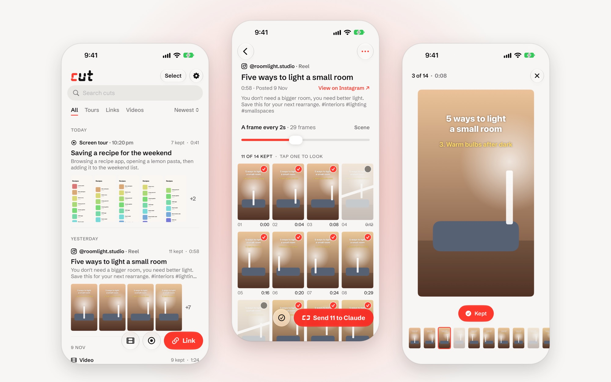
</picture>

## What it does

- **Share a video, get its frames.** An Instagram reel, a TikTok, a YouTube video or anything in Photos. Cut takes a frame every few seconds, or one each time the picture settles on something new.
- **Screen tours.** Start a tour, use your phone as normal, and Cut keeps a still each time the screen changes. The Dynamic Island counts down to the next frame and keeps the tally.
- **Keep or drop.** Every frame is kept to start with. Tap one to look closer, pinch to zoom, and drop the ones you don't need.
- **Send to Claude.** One button shares the kept frames, in batches of 16 so each message fits.
- **Named for you.** Each cut gets a short title from what's on screen: a reel's own heading if it has one, otherwise one written on device from the caption and the text in the frames.
- **Change your mind.** Slide from a frame every 0.25 s to one every 10 s, or switch to one per scene. The video is cut again when you let go.
- **System, Light or Dark.** Picked in Settings.

## How it works

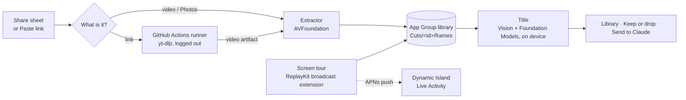

**Fetching, logged out.** Links go to a GitHub Actions workflow ([`server/video.yml`](server/video.yml)) in a private repo of your own. The runner downloads the post with [yt-dlp](https://github.com/yt-dlp/yt-dlp), with no cookies and no account, so Cut only ever sees what a logged-out visitor sees. Cut downloads the video, reads the post's details, then deletes the run.

**Picking frames.** [`Extractor.swift`](App/Extractor.swift) either steps through the video at a fixed interval or watches for scene changes. A scene change has to differ from the last kept frame *and* have stopped moving, so a scroll or a transition is never caught half-way ([`FrameDiff.swift`](Shared/FrameDiff.swift)). That check runs on 32×32 greyscale thumbnails, which is cheap enough to do four times a second.

**Screen tours.** A ReplayKit broadcast extension watches the screen while you use other apps ([`SampleHandler.swift`](Broadcast/SampleHandler.swift)). It only has about 50 MB to work in, so it compares tiny thumbnails and renders only the frames it keeps. A backgrounded app can't keep its own Live Activity up to date, so the extension updates the Dynamic Island itself with APNs pushes ([`IslandPush.swift`](Broadcast/IslandPush.swift)). The pushes carry exact future times, and the Island counts down to them on its own, so a late push never shows the wrong number.

**A title.** Vision reads the text off a spread of frames. If the same large line stays on screen across most of them, that's the video's own title, used word for word. Otherwise Apple's Foundation Models writes one from the caption and the text, all on the phone ([`TourNamer.swift`](App/TourNamer.swift)).

**No secrets in the code.** The GitHub token lives in the Keychain, shared with the share extension through the App Group. The APNs key is written into a gitignored file at build time by [`tools/secrets.sh`](tools/secrets.sh) and never goes into git.

## The mark: a c that's also a bracket

Square off a lowercase c and it's an open bracket. Set it facing a mirrored copy and you get [ ], the corners you'd drag around the part of a picture you want. One diagonal cut goes through the whole thing, and the top half slips to the right. That's the **Sliced** mark: the cut is in the logo, and it's what happens to a frame you drop.

<p align="center">
  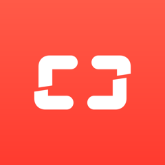
  &nbsp;&nbsp;&nbsp;
  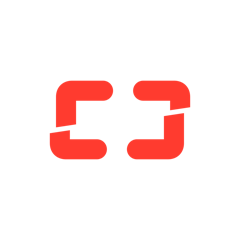
  &nbsp;&nbsp;&nbsp;
  <picture>
    <source media="(prefers-color-scheme: dark)" srcset="docs/wordmark-dark.svg">
    
  </picture>
</p>

### How it got here

Cut is [Jot](https://github.com/KezLahd/jot)'s sibling. Jot turns speech into words and its j bends into a quote mark, so Cut had to find a letter that already almost is a symbol for pictures. It was worked out on a few boards, one decision at a time, shown here in the final record red.

**1 · Letters that become the symbol.** Three names first. **Still**, whose double l is a pause sign; **Look**, whose oo is a pair of eyes; and **Lift**, whose two L's make a viewfinder's crop corners. Each one worked as a trick, but none was as clean as Jot's j.

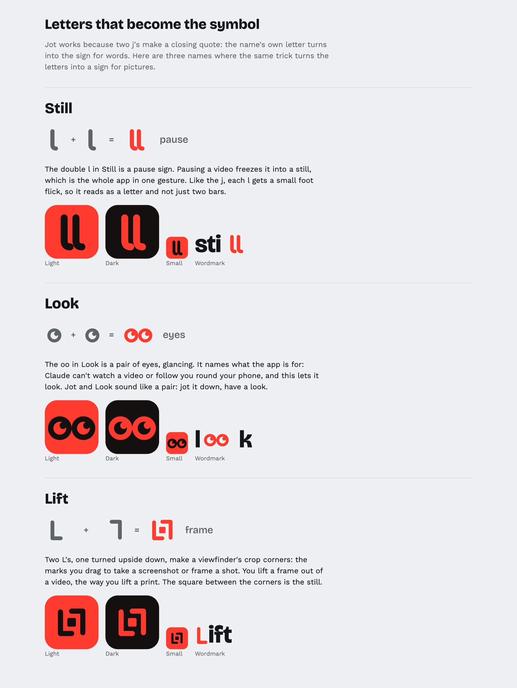

**2 · The bracket.** Cut won because its c only needs squaring off to become [. Three ways to draw the brackets, and two wordmarks built from them. **True brackets** won: a tight corner and short arms, like the [ ] on a keyboard, and every letter of the word built from that one stroke.

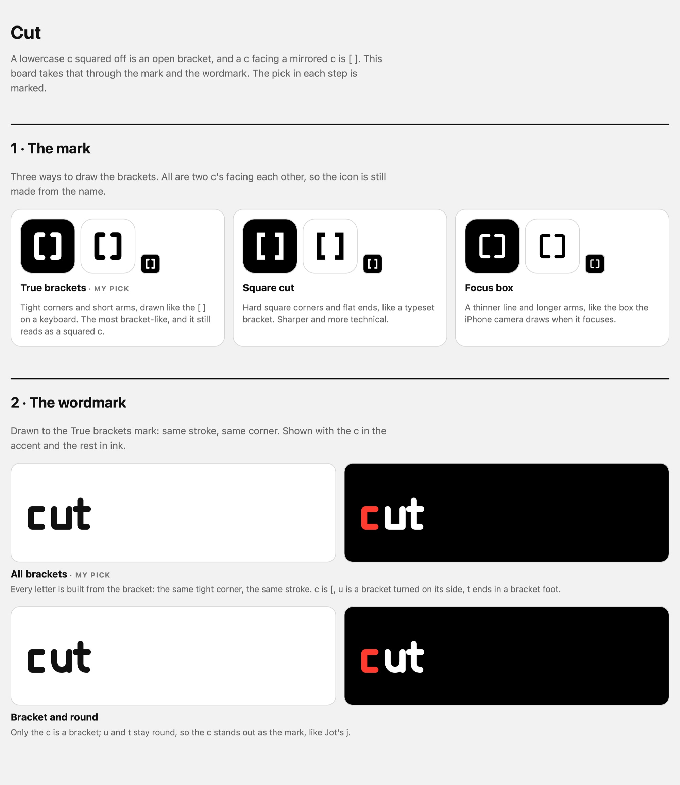

**3 · Spacing.** Each bracket style got its own u and t, drawn from the same stroke, corner and line ends. The spacing starts from Jot's equal-gap rule, then opens up a little, because these letters have straight sides.

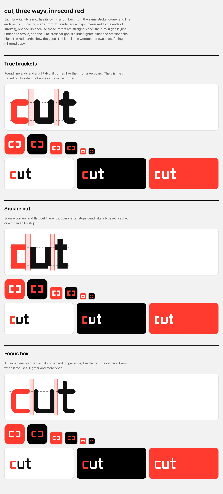

**4 · Sliced, in record red.** One diagonal cut through the word and the icon, with the top half nudged right. Record red `#FF3B2F` is the red of a record button and an editor's razor tool. Then came the first screens, with a dropped frame sliced the same way. The type is **Schibsted Grotesk** for everything, with **JetBrains Mono** for times and counts.

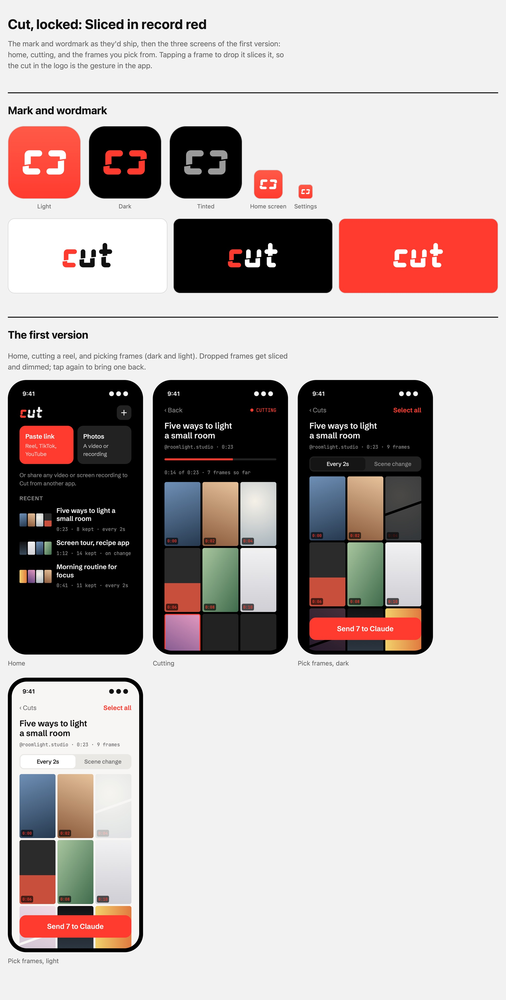

### Pull to refresh

The mark comes alive in the app. Pull down the list and one bracket splits into [ and ] that spread apart, turning red once letting go will refresh. Let go and a strip of film rolls between them for as long as the refresh takes. When it's done, the strip stops, one diagonal cut goes through it, and the brackets slam shut into the sliced mark ([`PullBrackets.swift`](App/PullBrackets.swift)).

<p align="center">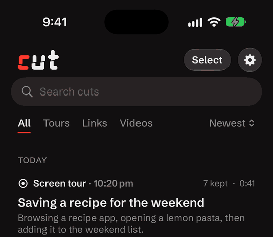</p>

## Design

Cut is a tool: share a video in, pick the frames, send them on. Everything that isn't the frames gets out of the way.

<table>
  <tr>
    <td>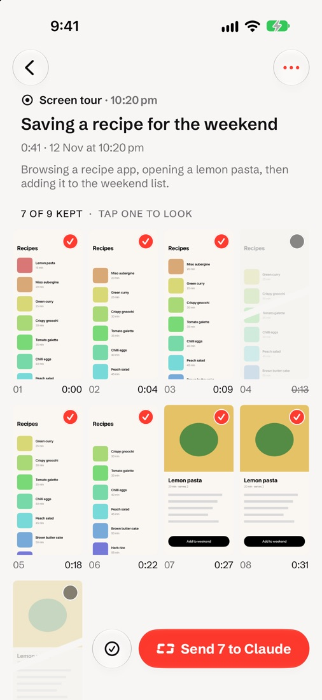</td>
    <td>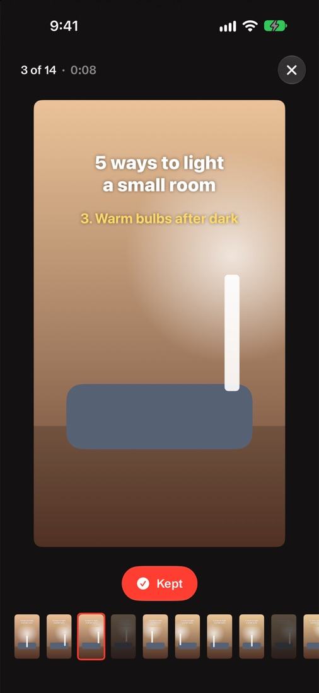</td>
    <td>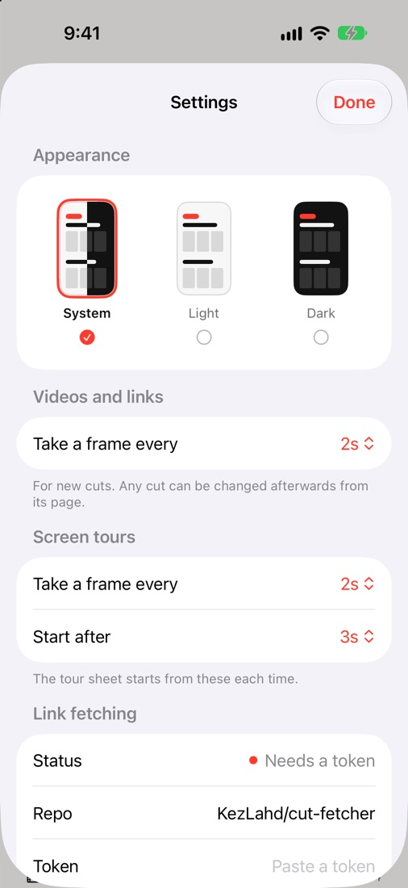</td>
    <td>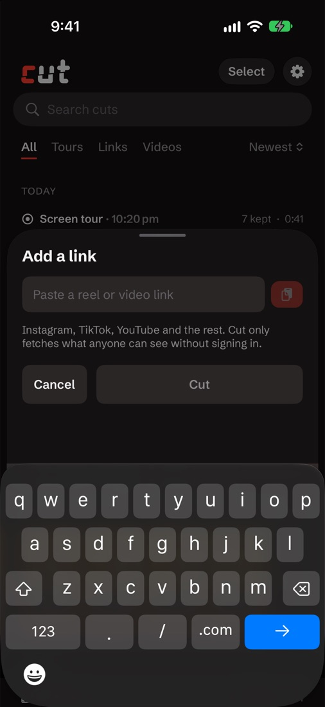</td>
  </tr>
</table>

- **One accent.** Record red `#FF3B2F` is only for things you act on (Link, Send to Claude, Kept) and for what's selected. Everything else is ink and grey.
- **Two typefaces.** [Schibsted Grotesk](https://fonts.google.com/specimen/Schibsted+Grotesk) for all the text, [JetBrains Mono](https://www.jetbrains.com/lp/mono/) for times and counts only. Both are open-licence and bundled.
- **No containers.** Inline rows under hairlines, Liquid Glass only on the controls, and text set a step further in than the glass around it.
- **Thinking orbs for waiting.** Not spinners: from [ThinkingOrbsKit](https://github.com/Jakubantalik/Libraries.dev).

| Token | Light | Dark |
|---|---|---|
| Background | `#F7F6F4` | `#131111` |
| Surface | `#FFFFFF` | `#1E1B1B` |
| Ink | `#111111` | `#F3F3F3` |
| Muted | `#6E6E6E` | `#8B8B8B` |
| Accent | `#FF3B2F` | `#FF3B2F` |

## The code

```
App/          SwiftUI: library, a cut and its frames, the frame viewer, settings, extracting, naming
Share/        The share extension: takes a link or a video from any app
Broadcast/    The ReplayKit broadcast extension for screen tours, and its Island pushes
Widgets/      The Live Activity and Dynamic Island
Shared/       Models, the App Group, frame comparison, cloud dispatch, Keychain
server/       The GitHub Actions workflow that fetches a public post with yt-dlp
tools/        Build to a phone, upload to TestFlight, write the APNs key, make the icon
```

## Build it yourself

1. Xcode 26 or later on macOS 26, and [XcodeGen](https://github.com/yonaskolb/XcodeGen) (`brew install xcodegen`).
2. In `project.yml`, change the team, the bundle IDs (`com.kezlahd.cut…`) and the App Group to your own, then run `xcodegen`.
3. The Island pushes need an APNs key. Put your `.p8` in `~/.appstoreconnect/apns/` (or point `CUT_APNS_P8` at it) and run:
   ```bash
   tools/secrets.sh
   ```
4. Open `Cut.xcodeproj` and build the **Cut** scheme for an iPhone.

Link fetching is optional. Put [`server/video.yml`](server/video.yml) in a private repo of your own as `.github/workflows/video.yml`, then paste that repo and a fine-grained token (Actions read and write, that repo only) into Settings › Link fetching.

## Credits

- [yt-dlp](https://github.com/yt-dlp/yt-dlp) does the fetching.
- [ThinkingOrbsKit](https://github.com/Jakubantalik/Libraries.dev) by Jakub Antalik (MIT), vendored unchanged in `App/ThinkingOrbsKit`.
- Schibsted Grotesk and JetBrains Mono, under the SIL Open Font License.

Designed and built by [Kez](https://github.com/KezLahd) with Claude.

## Licence

[MIT](LICENSE). Take it, learn from it, build on it. The bundled fonts keep their SIL Open Font License, and ThinkingOrbsKit keeps its own MIT licence.
